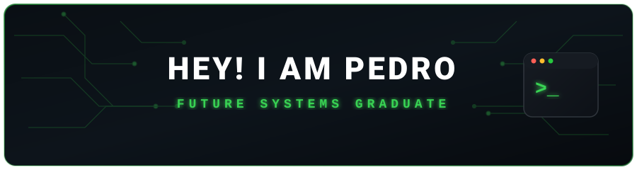
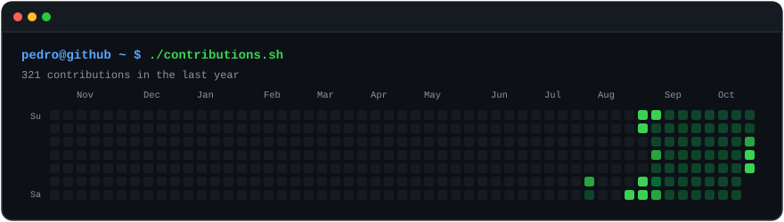
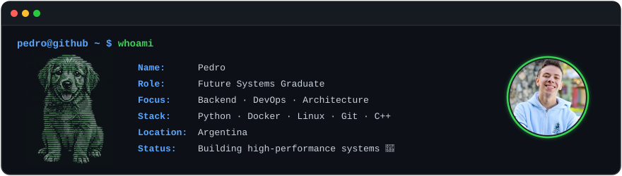
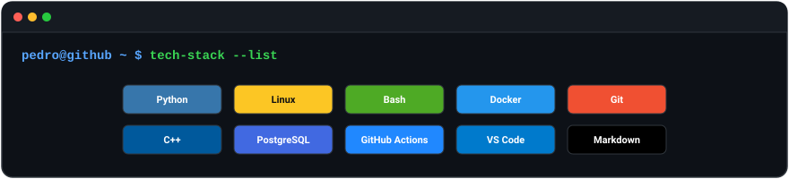

<!-- ========================================== -->
<!-- 1. HEADER BANNER                           -->
<!-- ========================================== -->

 

<!-- Contador de Visitas Funcional -->

  

<!-- ========================================== -->
<!-- 2. ./contributions.sh (Terminal Heatmap)   -->
<!-- ========================================== -->

  

<!-- ========================================== -->
<!-- 3. whoami (Terminal Identity Card)         -->
<!-- ========================================== -->

  

<!-- ========================================== -->
<!-- 4. tech-stack --list (Terminal Stack Card) -->
<!-- ========================================== -->

